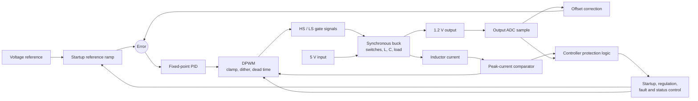
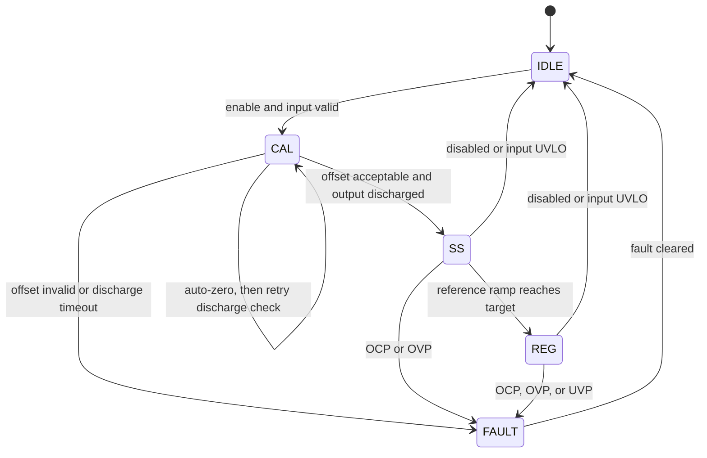
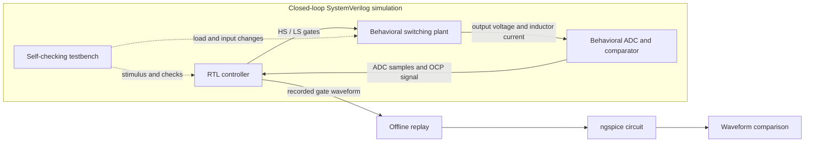
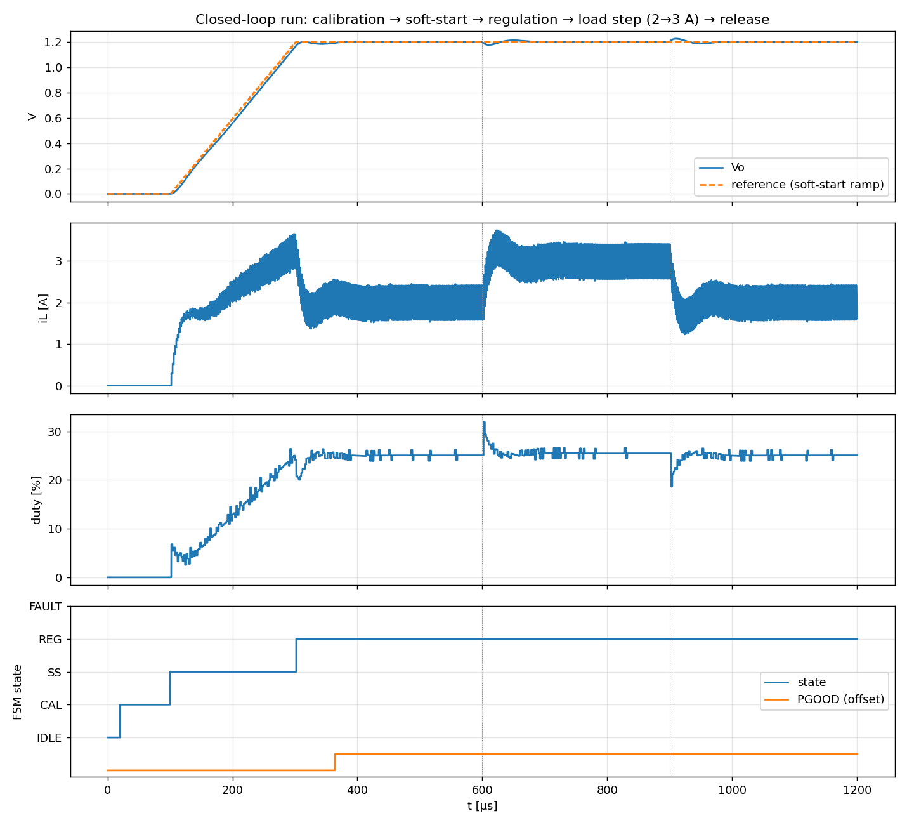
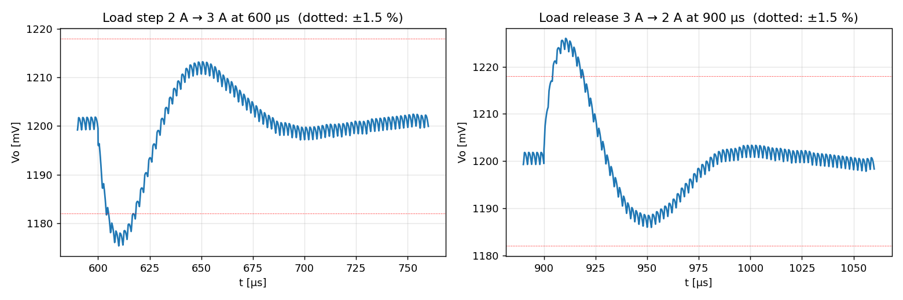
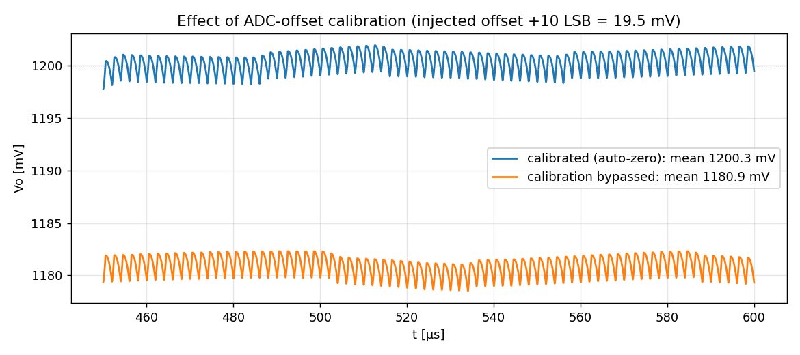
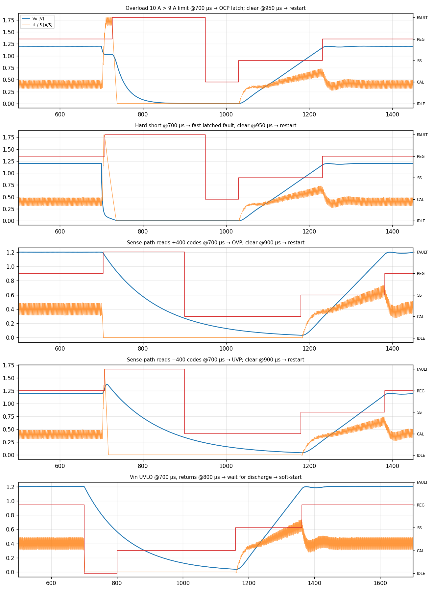
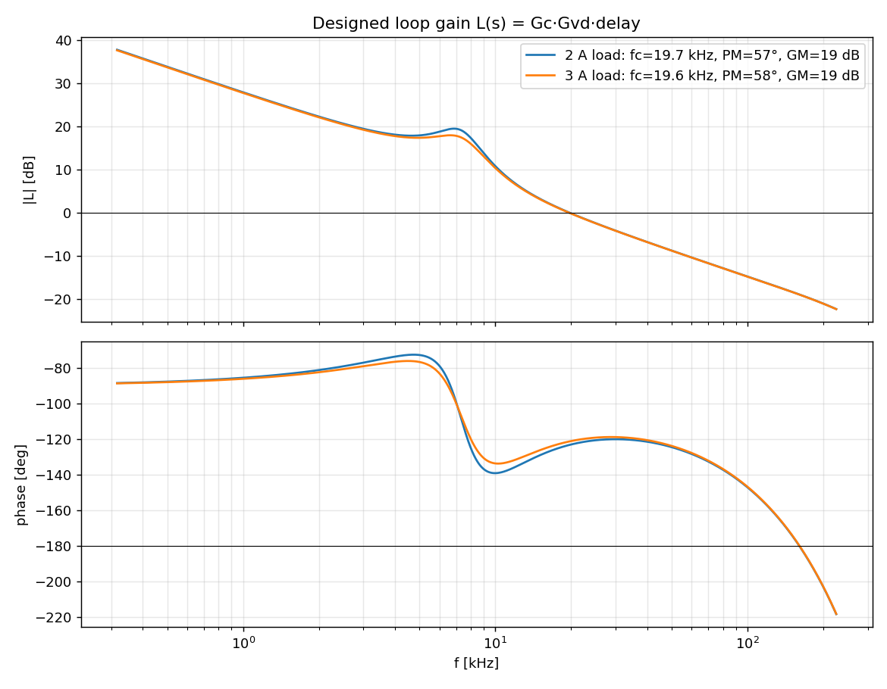
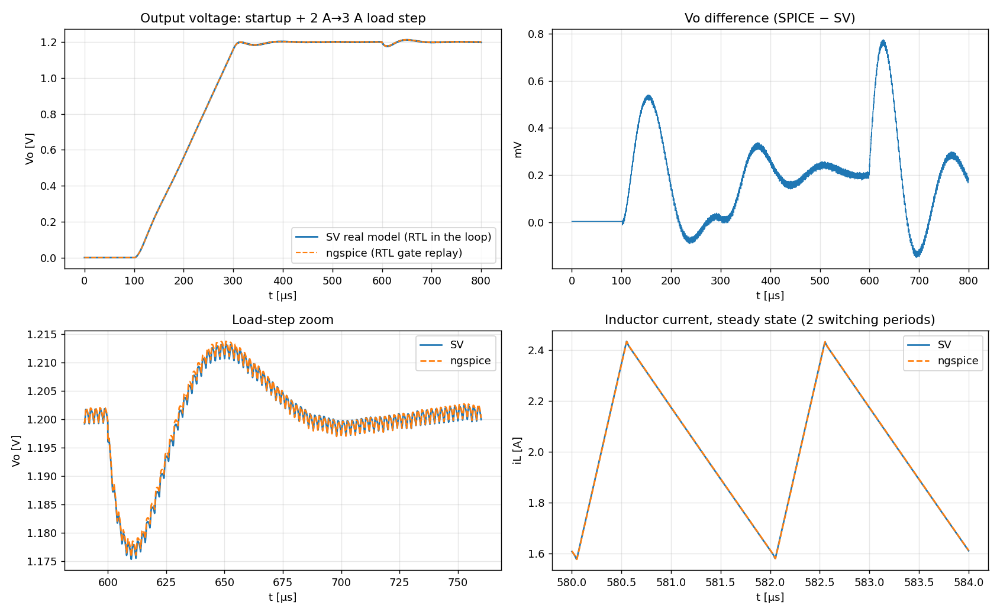

# Digital Buck-Converter Controller

A synthesizable SystemVerilog voltage controller for a synchronous buck converter. This project explores how a digital controller can regulate a switching power stage, start it safely, respond to load changes, and shut it down when measured conditions indicate a fault. The RTL is exercised in a closed-loop simulation with a switching behavioral plant and ADC model; a separate ngspice replay compares the plant response against an independent circuit simulation.

## The Problem

A buck converter turns a higher DC input into a lower regulated output. Its switches pulse at a fixed frequency, while the controller adjusts the fraction of each cycle spent delivering energy to the output. For this design, the representative operating point is 5 V in and 1.2 V out, with a 2 A nominal load. The controller must keep the output close to its reference even as the load changes, without creating unsafe gate overlap or allowing startup and fault conditions to run unchecked.

The diagram shows the core feedback loop. The digital controller measures the output once per switching cycle, calculates a new duty command, and drives the power stage. The resulting output is measured again, closing the loop.



The controller is voltage-mode: the PID uses output-voltage error to set duty. A separate peak-current comparator can truncate an individual high-side pulse; repeated current-limit events are also counted by the controller and can latch an overcurrent fault. This current limit is protection, not the primary regulation loop.

## Design At A Glance

| Item | Configuration |
|---|---|
| Power stage | 5 V input, 1.2 V target, 2 A nominal load; 3 A load-step test |
| Switching plant | L = 2.2 µH, C = 220 µF, switching frequency = 500 kHz |
| Digital timing | 400 MHz controller clock; 800 clock counts per switching period (2 µs) |
| Feedback | 10-bit ADC, 2 V full scale; one conversion initiated per switching period |
| Controller | Fixed-point PID, Q12 gain coefficients; duty represented with 3 fractional bits |
| Tools | Icarus Verilog, Verilator, Yosys, ngspice, Python with NumPy and Matplotlib |

At 400 MHz, each clock step is 2.5 ns. The switching period is 2 µs, so the ADC-driven control update is much slower than the controller clock: the PWM runs every clock, while the voltage loop receives one new measurement per period.

## How A Cycle Works

1. Near the end of each PWM period, the DPWM pulses `sample_tick` and starts an ADC conversion.
2. The ADC model returns a quantized output measurement after its conversion latency. The controller subtracts the calibrated ADC offset and compares the corrected sample with the current reference.
3. The PID combines proportional, accumulated, and derivative terms. Its integrator is clamped, conditional integration limits windup at saturation, and the output is clamped to the allowed duty range.
4. The DPWM applies the duty command at a period boundary. Fractional duty bits are accumulated across periods to dither between adjacent integer counts. Its output logic inserts dead time between high-side and low-side gate signals.
5. The switches and output filter change the inductor current and output voltage. The next ADC sample measures the updated output and repeats the cycle.

## Startup And Protection

Startup is deliberately staged. Calibration first measures the ADC offset with its input muxed to ground. It then measures the actual output, with that offset removed, and waits for the output to discharge below a threshold before enabling soft-start. This prevents a residual output voltage on restart from being mistaken for sensor offset. During soft-start the voltage reference ramps to its target over 100 switching periods (200 µs), and the PID regulates throughout the ramp.



| Protection / status | Behavior |
|---|---|
| ADC calibration | Rejects an offset above the configured limit; calibration can be bypassed with `cal_en` |
| Discharge / pre-bias check | Retries the output measurement before startup; latches a pre-bias fault if the output stays charged |
| Cycle-by-cycle current limit | Comparator truncates the high-side pulse for the current period |
| OCP | Latches a fault after the configured number of consecutive current-limited periods |
| OVP | Latches after the corrected ADC reading exceeds the overvoltage threshold for the debounce count |
| UVP | In regulation, latches after the corrected reading stays below the undervoltage threshold |
| UVLO / disable | Returns the FSM to idle and turns off PWM; a later restart repeats calibration and discharge checking |
| PGOOD | Asserts after a debounced in-window reading in regulation; drops using a wider hysteresis window |

## RTL And Models

| File | Responsibility |
|---|---|
| [`rtl/buck_ctrl.sv`](rtl/buck_ctrl.sv) | State machine, ADC calibration, reference ramp, sampled error pipeline, PGOOD, OCP/OVP/UVP and UVLO handling |
| [`rtl/pid_ctrl.sv`](rtl/pid_ctrl.sv) | Fixed-point PID: $K_p + K_i/(1-z^{-1}) + K_d(1-z^{-1})$, clamped duty and conditional-integration anti-windup |
| [`rtl/dpwm.sv`](rtl/dpwm.sv) | Trailing-edge PWM, dead time, duty dithering and per-cycle peak-current pulse truncation |
| [`model/afe_model.sv`](model/afe_model.sv) | Simulation-only ADC/comparator model with quantization, conversion latency, optional noise and injectable offset |
| [`model/buck_plant.sv`](model/buck_plant.sv) | Simulation-only switching plant using real-valued arithmetic, including switch resistance, body-diode dead time, DCM, ESR and DCR |
| [`tb/tb_buck.sv`](tb/tb_buck.sv) | Closed-loop scenarios, waveform capture and self-checking assertions |
| [`scripts/design_compensator.py`](scripts/design_compensator.py) | Averaged small-signal plant and loop model used to choose the PID gains |

## Verification Approach

The closed-loop testbench connects the synthesizable controller to a behavioral switching plant and a behavioral ADC/comparator. It exercises startup, calibration, steady-state regulation, load transients, and injected faults. The ngspice check is a separate, one-way replay: recorded RTL gate waveforms drive the SPICE circuit, and the resulting waveforms are compared afterward. It is not a closed feedback loop between RTL and ngspice.



The testbench covers eight scenarios: normal startup and load transients, calibration bypass, calibration failure, overload, hard short, injected overvoltage, injected undervoltage, and input UVLO. `make run` executes all scenarios and reports the self-check results.

## Representative Results

All values below are from the current behavioral simulations and configured test cases, not hardware measurements.

| Test | Result |
|---|---|
| Compensator model | Crossover ≈ 19.7 kHz; phase margin 55–58° (54.7° at 1 A); gain margin ≈ 19 dB |
| ADC offset calibration | Correctly measured injected +10 LSB; DC error +0.04% vs. −1.6% without calibration |
| Startup | 200 µs soft-start; 0.32% overshoot; 3.7 A peak inrush; PGOOD at ≈ 364 µs |
| Steady state | 3.5 mV peak-to-peak output ripple; 0.89 A peak-to-peak inductor ripple |
| 2 A → 3 A load step | 24.7 mV droop (2.1%); returns within ±1.5% in 18 µs |
| 3 A → 2 A load release | 26 mV overshoot (2.2%); returns within ±1.5% in 19 µs |
| 10 A overload, 9 A limit | Inductor current held at 9.02 A; OCP latched after 26 µs; restart succeeded after clear |
| Hard short | 9.02 A peak; fault latched in 8 µs; UVP precedes OCP; restart succeeded |
| Injected OVP / UVP | Latched in 4 µs / 8 µs; gates disabled; restart succeeded |
| UVLO | Reached idle in about 4 ns (1–2 clocks); waited for output discharge before restarting |
| Shoot-through | Zero cycles in every scenario |
| Yosys generic synthesis | Zero latches, 204 flip-flops, approximately 9.2k generic gates |
| SPICE replay | Output RMS difference 0.26 mV (maximum 0.78 mV) over 800 µs; inductor ripple 0.857 A vs. 0.856 A; load-step droop 24.7 vs. 24.1 mV |

### Startup And Load Response

The normal scenario includes soft-start, a 2 A to 3 A load step, and a load release. The transient plot focuses on the output response around the load changes.





### Calibration And Fault Handling

The calibration plot shows the ADC zero measurement and the separate output-discharge check. Fault scenarios verify that the controller disables the gates and requires a clear before restarting.





### Model Cross-Check

The compensator plot comes from the averaged small-signal model; its margins are analytical estimates, not measurements from the switching simulation. The SPICE plot compares an offline replay against the SystemVerilog behavioral plant.





## Run It

Requirements: Icarus Verilog for the simulation, plus Verilator and Yosys for lint and synthesis checks. The SPICE comparison additionally requires ngspice; plots require Python with NumPy and Matplotlib.

```sh
make run        # compile and run all eight scenarios; logs and waveforms go to results/
make lint       # lint the RTL with Verilator
make synth      # run the generic Yosys synthesis sanity check
make design     # print estimated loop margins for the configured gains
make plots      # regenerate the result figures in docs/
make spice      # replay recorded RTL gate waveforms through ngspice; run after make run
vvp -n build/sim.vvp +SCEN=main +ADC_OFF=25  # run one scenario with a custom ADC offset
```

`make run` executes `main`, `nocal`, `calfail`, `ocp`, `short`, `ovp`, `uvp`, and `uvlo`. The `ADC_OFF` plusarg sets the injected ADC offset in LSBs for a direct simulator invocation.

## Design Notes

1. **The integrator was initially too slow.** With $K_i = 0.03$, load-step checks passed, but soft-start lagged by about 80 mV and then crept for roughly 75 µs. Increasing $K_i$ to 0.10 reduced the time constant to about 26 µs, with phase margin in the mid-50° range.
2. **The first OCP test was actually a short-circuit test.** UVP fired first, so that scenario did not isolate overcurrent behavior. Separate overload and hard-short cases now exercise the intended paths.
3. **Calibration initially mixed sensor offset with residual output voltage.** On restart, the still-discharging output was interpreted as ADC offset, causing regulation about 7% high. Calibration now grounds the ADC input for auto-zero, then performs a distinct corrected-output discharge check.
4. **A reset structure passed simulation but failed synthesis.** Combining asynchronous reset and synchronous clear in one condition was rejected by Yosys. The PID now uses an asynchronous reset and a separate synchronous clear.

## Scope And Limitations

- The closed-loop plant uses a SystemVerilog `real` behavioral model with a fixed 2.5 ns step. It is not a transistor-level model, `wreal`, or UVM-AMS simulation.
- The ngspice comparison is an offline gate-waveform replay with no feedback inside ngspice. It cross-checks the behavioral plant response; it is not lock-step mixed-signal co-simulation. There is no Verilog-A model in this project.
- Component values, targets, and pass thresholds are representative project choices, not customer specifications. Testing covers a resistive load, nominal components, one input voltage plus UVLO, and no Monte Carlo or temperature/tolerance sweep.
- There are no input-voltage transient tests and no pre-biased soft-start. The controller waits for the output to discharge before startup.
- ADC auto-zero measures positive offsets only; the modeled ADC clamps at zero codes.
- Loop design uses an averaged small-signal model with approximate delay. Crossover and phase margin are not measured in switching simulation.
- The derivative gain ($K_d = 8$) amplifies ADC quantization noise, occasionally moving duty by a few counts. The simulated output ripple remains 3.5 mV peak-to-peak.
- The UVP scenario injects a fault into the sense path. Because the controller temporarily loses valid feedback, output can reach about 1.37 V (+14%) before UVP latches. A real design should include independent hardware overvoltage protection.
- Three single-cycle 40-bit multipliers dominate the estimated area. Yosys reports generic cells, not a timing-closed implementation; a time-shared multiplier could reduce area.
- This design has not been run on an FPGA or in silicon.
